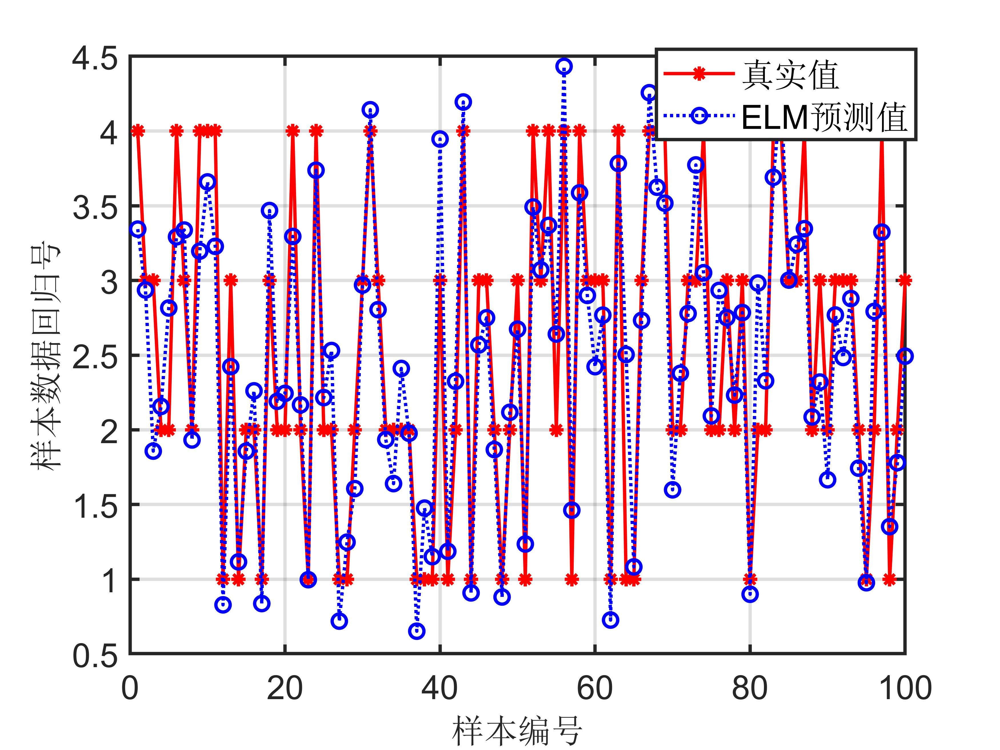
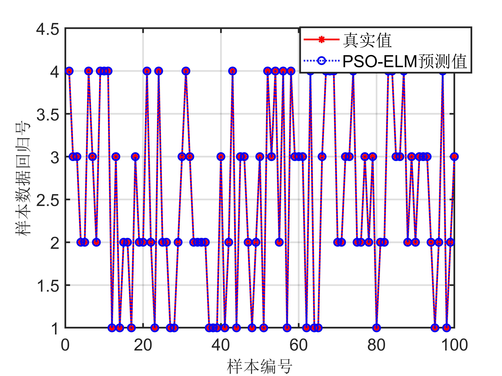

# Classification Algorithm Based on PSO-Optimized ELM in MATLAB Code

This algorithm integrates the Particle Swarm Optimization (PSO) algorithm with the Extreme Learning Machine (ELM) to optimize the parameters of ELM, achieving the optimal classifier and thereby realizing the optimal classification effect.
\n        \n  
\n        \n      Partial code display: clc\n\nclear all\n\n%% Load data\n\nload('x1.mat');\n\nload('c1.mat');\n\ndata_train=x1(1:100,1:6); % Select training data\n\nlabel_train=x1(1:100,6);% Select training data category identifiers\n\ndata_test=c1(1:100,1:6);% Select test data\n\nlabel_test=c1(1:100,6); % Select test data category identifier\n\n\n\n\nAllSamIn = data_train';\n\nAllSamOut =label_train';\n\nAllTestIn=data_test';\n\nAllTestOut=label_test';\n\n\n\n\n%% Normalization of training samples\n\nglobal minAllSamOut;  \n\nglobal maxAllSamOut; \n\n[AllSamInn,minAllSamIn,maxAllSamIn,AllSamOutn,minAllSamOut,maxAllSamOut] = premnmx(AllSamIn,AllSamOut);\n\nTrainSamIn=AllSamInn; \n\nTrainSamOut=AllSamOutn;\n\nglobal Ptrain;\n\nPtrain = TrainSamIn;  \n\nglobal Ttrain;\n\nTtrain = TrainSamOut;  \n\n\n\n\n%% Test sample normalization\n\nglobal minAllTestOut;  \n\nglobal maxAllTestOut; \n\n[AllTestInn,minAllTestIn,maxAllTestIn,AllTestOutn,minAllTestOut,maxAllTestOut] = premnmx(AllTestIn,AllTestOut);\n\nTestIn=AllTestInn; \n\nTestOut=AllTestOutn;\n\nglobal Ptest;\n\nPtest = TestIn; \n\nglobal Ttest;\n\nTtest = TestOut; \n\n\n\n\n%% Load initial variables for the network\n\nglobal indim; \n\nindim=6;\n\nglobal hiddennum;\n\nhiddennum=100;              %Impact on classification accuracy\n\nglobal outdim;\n\noutdim=6;\n\n\n\n\n\n\n\n%% Load the relevant parameters of PSO model\n\nvmax=1; \n\nminerr=0.01; \n\nwmax=0.80; \n\nwmin=0.40; \n\nglobal itmax; \n\nitmax=100;\n\nc11=2.4; \n\nc22=1.6; \n\nfor iter=1:itmax\n\n  W(iter)=wmax-((wmax-wmin)/itmax)*iter; \n\nend\n\na=-1;\n\nb=1;\n\nm=-1;\n\nn=1;\n\nglobal N; \n\nN=10;\n\nglobal D; \n\nD=(indim+1)*hiddennum+(hiddennum+1)*outdim; \n\nrand('state',sum(100*clock));\n\nX=a+(b-a)*rand(N,D,1);\n\nV=m+(n-m)*rand(N,D,1);\n\nglobal fvrec;\n\nMinFit=[];\n\nBestFit=[];\n\n\n\n\n%% PSO optimization of ELM model process 1\n\nfitness=fitcal(X,indim,hiddennum,outdim,D,Ptrain,Ttrain,minAllSamOut,maxAllSamOut); \n\nfvrec(:,1,1)=fitness(:,1,1);\n\n[C,I]=min(fitness(:,1,1)); \n\nMinFit=[MinFit C];  \n\nBestFit=[BestFit C]; \n\nL(:,1,1)=fitness(:,1,1); \n\nB(1,1,1)=C; \n\ngbest(1,:,1)=X(I,:,1); \n\n\n\n\nfor p=1:N\n\n  G(p,:,1)=gbest(1,:,1); \n\nend\n\n\n\n\nfor i=1:N;\n\n  pbest(i,:,1)=X(i,:,1); \n\nend\n\nV(:,:,2)=W(1)*V(:,:,1)+c11*rand*(pbest(:,:,1)-X(:,:,1))+c22*rand*(G(:,:,1)-X(:,:,1));\n\n\n\n\nfor ni=1:N\n\n  for di=1:D\n\n    if V(ni,di,2) > vmax\n\n      V(ni,di,2) = vmax;\n\n    elseif V(ni,di,2) < -vmax\n\n      V(ni,di,2) = -vmax;\n\n    else\n\n      V(ni,di,2) = V(ni,di,2);\n\n    end\n\n  end\n\nend\n\n\n\n\nX(:,:,2)=X(:,:,1)+V(:,:,2);\n\n\n\n\nfor ni=1:N\n\n  for di=1:D\n\n    if X(ni,di,2) > 1\n\n      X(ni,di,2) = 1;\n\n    elseif V(ni,di,2) < -1\n\n      X(ni,di,2) = -1;\n\n    else\n\n      X(ni,di,2) = X(ni,di,2);\n\n    end\n\n  end\n\nend\n\n\n\n\n\n\n\n%% PSO optimizing ELM model process 2\n\nfor j=2:itmax\n\n  disp('Iteration and Current Best Fitness')\n\n  disp(j-1)\n\n  disp(B(1,1,j-1))\n\n  fitness=fitcal(X,indim,hiddennum,outdim,D,Ptrain,Ttrain,minAllSamOut,maxAllSamOut); \n\n  fvrec(:,1,j)=fitness(:,1,j); \n\n  [C,I]=min(fitness(:,1,j));\n\n  MinFit=[MinFit C]; \n\n  BestFit=[BestFit min(MinFit)]; \n\n  L(:,1,j)=fitness(:,1,j); \n\n  B(1,1,j)=C; \n\n  gbest(1,:,j)=X(I,:,j);\n\n  [C,I]=min(B(1,1,:));\n\n   \n\n  if B(1,1,j)<=C\n\n    gbest(1,:,j)=gbest(1,:,j);\n\n  else\n\n    gbest(1,:,j)=gbest(1,:,I);\n\n  end\n\n  if C<=minerr, break, end\n\n\n\n\n  if j>=itmax, break, end\n\n  for p=1:N\n\n    G(p,:,j)=gbest(1,:,j);\n\n  end\n\n  for i=1:N;\n\n    [C,I]=min(L(i,1,:));\n\n    if L(i,1,j)<=C\n\n      pbest(i,:,j)=X(i,:,j);\n\n    else\n\n      pbest(i,:,j)=X(i,:,I);\n\n    end\n\n  end\n\n   \n\n  V(:,:,j+1)=W(j)*V(:,:,j)+c11*rand*(pbest(:,:,j)-X(:,:,j))+c22*rand*(G(:,:,j)-X(:,:,j));\n\n   \n\n  for ni=1:N\n\n    for di=1:D\n\n      if V(ni,di,j+1)>vmax\n\n        V(ni,di,j+1)=vmax;\n\n      elseif V(ni,di,j+1)<-vmax\n\n        V(ni,di,j+1)=-vmax;\n\n      else\n\n        V(ni,di,j+1)=V(ni,di,j+1);\n\n      end\n\n    end\n\n  end\n\n  X(:,:,j+1)=X(:,:,j)+V(:,:,j+1);\n\n   \n\n  for ni=1:N\n\n    for di=1:D\n\n      if X(ni,di,j+1) > 1\n\n        X(ni,di,j+1) = 1;\n\n      elseif V(ni,di,j+1) < -1\n\n        X(ni,di,j+1) = -1;\n\n      else\n\n        X(ni,di,j+1) = X(ni,di,j+1);\n\n      end\n\n    end\n\n  end \n\nend\n\n\n\n\ndisp('Iteration and Current Best Fitness')\n\ndisp(j)\n\ndisp(B(1,1,j))\n\ndisp('Global Best Fitness and Occurred Iteration')\n\n[C,I] = min(B(1,1,:))\n\n\n\n\nfor t=1:hiddennum\n\n  x2iw(t,:)=gbest(1,((t-1)*indim+1):t*indim,j);\n\nend\n\nfor r=1:outdim\n\n  x2lw(r,:)=gbest(1,(indim*hiddennum+1):(indim*hiddennum+hiddennum),j);\n\nend\n\nx2b=gbest(1,((indim+1)*hiddennum+1):D,j);\n\nx2b1=x2b(1:hiddennum).';\n\nx2b2=x2b(hiddennum+1:hiddennum+outdim).';\n\n\n\n\nIWbest1=x2iw;\n\nIWbest2=x2lw;\n\nIBbest1=x2b1;\n\nIBbest2=x2b2;\n\n\n\n\nT_sim_test = ELMfun2(IWbest1,IBbest1,Ptest,Ttest,hiddennum,IWbest2,IBbest2);\n\ntestsamout = postmnmx(T_sim_test,minAllTestOut,maxAllTestOut); \n\nrealtesterr=mse(testsamout-AllTestOut);\n\nerr1=norm(testsamout-AllTestOut); \n\ndisp(['Optimize the simulation error of model testing samples:',num2str(err1)])\n\nN = length(Ttest);\n\nR1 = (N*sum(T_sim_test.*Ttest)-sum(T_sim_test)*sum(Ttest))^2/((N*sum((T_sim_test).^2)-(sum(T_sim_test))^2)*(N*sum((Ttest).^2)-(sum(Ttest))^2)); \n\n\n\n\n%% Not using PSO to optimize ELM algorithm\n\n[IW,B,LW,TF,TYPE] = elmtrain2(Ptrain,Ttrain,5,'sig',0);\n\nT_sim_test1 = elmpredict(Ptest,IW,B,LW,TF,TYPE);\n\ntestsamout2 = postmnmx(T_sim_test1,minAllTestOut,maxAllTestOut);\n\nrealtesterr2=mse(testsamout2-AllTestOut);\n\nerr2=norm(testsamout2-AllTestOut);  \n\nR2 = (N*sum(T_sim_test1.*Ttest)-sum(T_sim_test1)*sum(Ttest))^2/((N*sum((T_sim_test1).^2)-(sum(T_sim_test1))^2)*(N*sum((Ttest).^2)-(sum(Ttest))^2)); \n\ndisp(['Simulation error of original model test samples:',num2str(err2)])\n\n\n\n\n\n\n\n%% Output parameters graph\n\n% PSO optimization iteration graph\n\nfigure(1);\n\n% P0 = plot(1:itmax,BestFit);\n\ngrid on\n\nxlabel('PSO items');\n\nylabel('MSE rate');\n\nstring = {'PSO-ELMModel100Iteration error variation';['R-squared:R^2=' num2str(R1) ' ' ];['Mean Squared Error of Model Simulation:mse=' num2str(realtesterr) ' ']};\n\ntitle(string)\n\nbestErr=min(BestFit);\n\nfprintf(['PSO-ELMModel:\nR-squaredR^2=',num2str(R1),'\nMean Squared Error of Model Simulation:mse=',num2str(realtesterr),'\n'])\n\n% set(P0,'LineWidth',1.5);   \n\n% PSO vs ELM result comparison graph\n\nfigure(2)\n\nP1=plot(1:100,AllTestOut,'r-*',1:100,testsamout,'b:o')\n\ngrid on\n\nlegend('True value','PSO-ELMPredicted value')\n\nxlabel('Sample number')\n\nylabel('Sample data regression number')\n\nstring = {'Test set - Prediction Classification - Result Comparison(True value & PSO-ELM & ELM)';['PSO-ELM:(mse = ' num2str(realtesterr) ' R^2 = ' num2str(R1) ')']};\n\ntitle(string)\n\nset(P1,'LineWidth',1.0);   \n\nfigure(3)\n\nP1=plot(1:100,AllTestOut,'r-*',1:100,testsamout2,'b:o')\n\ngrid on\n\nlegend('True value','PSO-ELMPredicted value')\n\nxlabel('Sample number')\n\nylabel('Sample data regression number')\n\nstring = {'Test set - Prediction Classification - Result Comparison(True value & PSO-ELM & ELM)';['PSO-ELM:(mse = ' num2str(realtesterr) ' R^2 = ' num2str(R1) ')']};\n\ntitle(string)\n\nset(P1,'LineWidth',1.0);  \n\nyouhua_test_accuracy=sum(AllTestOut==testsamout)/length(label_test)\n  

## Images

<!-- PAYMENT_BLOCK -->

## Get this dataset

- Payment link (Stripe): [Buy now](https://buy.stripe.com/3cs8yP7sY87d0vu9AB)
- Payment QR code: 

<!-- /PAYMENT_BLOCK -->
